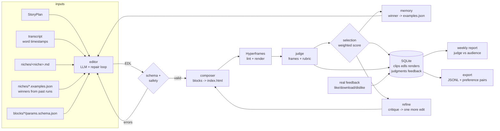

# RelatiV edit engine

Motion-graphics editing for vertical clips: a story plan plus a word-timed
transcript goes in, a judged, rendered winner comes out. The LLM never writes
HTML; it selects blocks and fills parameters, and deterministic code renders them
with [Hyperframes](https://hyperframes.heygen.com).

This lives beside the product (the FastAPI backend, the framing pipeline and the
Next frontend) but is independent: its own SQLite database, its own venv, and no
imports from `backend/`.



## Quick start

```bash
cd /Users/deeprajsharma/Downloads/RelatiVClips

# 1. deps (Python 3.11+; this repo runs 3.14) and media tooling
brew install ffmpeg
python3 -m venv .venv_edit
.venv_edit/bin/pip install -r requirements-edit-engine.txt

# 2. Hyperframes: render contract, Chrome and the 5s fixtures
npx hyperframes browser ensure
.venv_edit/bin/python scripts/make_fixtures.py
./scripts/hello_render.sh          # sandbox project + one 5s render

# 3. the engine (mock mode needs no API key)
.venv_edit/bin/python -m loop run --clip demo_01 --variants 6 --mock
.venv_edit/bin/python -m loop report --days 7
```

Outputs land in `data/renders/<clip_id>/`: `v*_<style>.mp4`, `winner.mp4`,
`winner.edl.json`, and one `proj_v*/` Hyperframes project per variant.

## Environment

Everything model-related is env-driven; nothing is hard-coded to a provider.

| Variable | Default | What it does |
| --- | --- | --- |
| `EDIT_LLM_BASE_URL` | `https://models.jarvislabs.net/v1` | OpenAI-compatible base URL for the editor (Token Factory; DeepSeek native and OpenRouter also work) |
| `EDIT_LLM_API_KEY` | falls back to `DEEPSEEK_API_KEY`, `OPENROUTER_API_KEY` | editor key |
| `EDIT_LLM_MODEL` | `glm-5.3-flash` | editor model; also hosted: `deepseek-v4.1-flash-1017` |
| `EDIT_JUDGE_BASE_URL` | `https://openrouter.ai/api/v1` | vision endpoint for the judge |
| `EDIT_JUDGE_API_KEY` | falls back to `OPENROUTER_API_KEY`, `ANTHROPIC_API_KEY` | judge key |
| `EDIT_JUDGE_MODEL` | `anthropic/claude-haiku-5.5` | vision model name |
| `EDIT_MOCK` | auto | `1` forces mock EDLs/reports; otherwise auto-mock when a stage has no key |
| `EDIT_DB_URL` | `sqlite:///data/edit_engine.db` | SQLAlchemy URL (Postgres-ready) |
| `EDIT_HYPERFRAMES_VERSION` | `0.9.104` | pinned CLI version for reproducible renders |
| `EDIT_HYPERFRAMES_CLI` | `npx -y hyperframes@<version>` | override the whole CLI command |
| `EDIT_RENDER_WORKERS` | `1` | `--workers` for a single render; `>1` is faster but breaks frame-exact determinism |
| `EDIT_MAX_RENDER_WORKERS` | `2` | how many variants render in parallel |
| `EDIT_DEFAULT_VARIANTS` | `6` | default variant count |
| `EDIT_FPS` | `30` | render frame rate |
| `EDIT_PROMPT_VERSION` | `v1` | editor prompt folder |
| `EDIT_JUDGE_PROMPT_VERSION` | `v1` | rubric folder |
| `EDIT_LLM_TEMPERATURE` | per style | 0.45 minimal / 0.7 punchy / 0.95 chaotic |
| `EDIT_LLM_MAX_TOKENS` | `8192` | completion headroom; reasoning tokens count against it |
| `EDIT_JUDGE_TEMPERATURE` | `0.0` | judge sampling |
| `EDIT_WEIGHTS_PATH` | `loop/weights.json` | selection weights |
| `EDIT_REQUIRE_PRODUCTION_READY` | `1` | only pick production-ready winners when any exist |
| `EDIT_NICHES_DIR` / `EDIT_DATA_DIR` / `EDIT_RENDERS_DIR` | repo dirs | path overrides for tests |

The DeepSeek endpoint is an assumption kept behind these vars: if the event
hands you a different base URL or model, it is a config change, not a code change.

## CLI

```bash
python -m loop run --clip demo_01 --variants 6          # variants -> winner
python -m loop run --clip demo_02 --variants 3 --styles punchy,minimal
python -m loop report --days 7                          # judge vs real feedback
python -m loop regression --clips 10                    # before/after delta table
python -m loop regression --update-baseline
python -m loop export --out data/dataset.jsonl          # fine-tuning rows + preferences
python -m loop feedback --edl-id 12 --kind download

python scripts/token_report.py --days 14                # tokens per day per stage
python -m judge.consistency --clip demo_01 --runs 3     # rubric variance table
python -m judge.calibrate --csv judge/calibration_template.csv --mock
```

`--mock` runs the whole pipeline with canned EDLs and canned judge reports, so
the orchestration, persistence and rendering are testable with no API key.

## Contracts

Three versioned contracts, defined once in `schemas/models.py` and exported to
`schemas/json/` by `python -m schemas.compile`:

- **StoryPlan** — clip_id, duration_s, segments (hook/info/rehook/cta), callbacks.
- **EDL** — clip_id, niche, effects (`shake|motion_blur|caption_style|popup|sfx|zoom`)
  with start/end/params/rationale.
- **JudgeReport** — five 1-10 scores, critique, production_ready.

`schemas/validate.py` is a strict validator that returns messages like
`$.effects[1].start: must be >= 0 (got -1.5)`. Those exact strings are what the
editor and judge get back in a repair turn.

## Safety rules (encoded, not prompted)

`composer/safety.py` - the brief's rule was ambiguous, so it is pinned down here:

- No two **impact** effects (shake, motion_blur, popup, zoom) start within 300ms.
- No two camera moves (shake, motion_blur, zoom) overlap in time: they share the
  source transform.
- At most 3 impact effects per 10s window; at most 2 impact effects in the 0-2s hook.
- `caption_style` and `sfx` are layers, not punctuation: they do not count against
  those caps, but two caption blocks may not overlap and a non-top popup may not
  overlap captions.

Violations come back as errors. Out-of-range numbers are clamped with a warning
(and the clamp is recorded); unknown block types, unknown params, and missing
assets are rejected.

## Determinism

Hyperframes seeks a paused timeline frame by frame, so a given composition
renders identically. Two things matter:

1. **Pin the CLI version** (`EDIT_HYPERFRAMES_VERSION`).
2. **Render with `--workers 1`.** With `workers=auto` the last ~0.7s of two
   otherwise identical renders differed in 22 of 150 frames; with a fixed worker
   count, decoded-frame MD5s match exactly. `tests/test_render_determinism.py`
   asserts that, plus identical decoded audio.

Composition HTML depends only on (EDL, source, transcript): no timestamps, no
random ids, no absolute paths - so composing twice is byte-identical.

## Learning without fine-tuning

`loop/memory.py` writes each winner to `niches/<niche>.examples.json` (deduped by
EDL hash, capped at 40, low scorers pruned). The editor reads the top 3 by score,
one per effect mix, and embeds them in the system prompt. No weights move; the
prompt gets better examples.

`loop/feedback.py` records real signals and the weekly report flags niches where
the judge and the audience disagree, suggesting a weight change - never applying
one.

## Layout

```
schemas/    contracts, JSON Schema export, strict validator, SQLAlchemy models
blocks/     block library: params.schema.json + fragment.html + anim.js + demo.html
composer/   EDL -> Hyperframes project, safety rules, lint+render, media helpers
editor/     LLM wrapper, prompt v1, niche/catalog/few-shot assembly, repair loop
judge/      frame sampling, rubric v1, vision call, calibration, consistency
loop/       pipeline, selection, refine, memory, feedback, regression, export, CLI
niches/     livestream_comedy.md + the examples memory file
data/       fixtures, assets (manifest), renders, sqlite db, regression set
tests/edit_engine/  fast unit tests + slow render/determinism tests
                       (pytest.ini points here; the product suite stays in tests/unit)
scripts/    hello_render.sh, fixtures, token report, block demos
```

## Tests

```bash
.venv_edit/bin/python -m pytest -q                 # everything (renders included)
.venv_edit/bin/python -m pytest -q -m "not slow"   # fast only
```

Slow tests render real video: determinism (two renders of the same composition),
the end-to-end pipeline, calibration, consistency, and the regression table.
