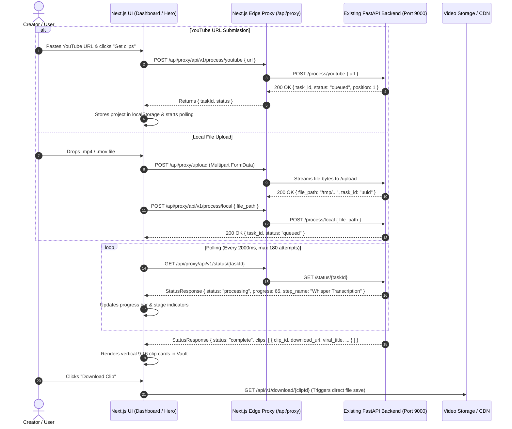

# RelatiV Clips — Frontend Architecture & Backend Integration Guide

> **CRITICAL HANDOFF CONTRACT FOR CLIENT & RECEIVING AI DEVELOPER:**
> This repository contains the complete, approved, production-grade frontend UI/UX for **RelatiV Clips**. The visual design, layouts, typography, animations, responsive behaviors, and micro-interactions are **visually locked and approved**.
> The client maintains an **existing backend service** (FastAPI / Celery / FFmpeg / PostgreSQL). Your sole responsibility during integration is to **adapt the frontend data layer to the existing backend endpoints without altering or redesigning the approved UI/UX**.

---

## Table of Contents
1. [Project Summary & Product Overview](#1-project-summary--product-overview)
2. [Verified Technology Stack](#2-verified-technology-stack)
3. [Repository Directory Structure](#3-repository-directory-structure)
4. [Routing Architecture & Subdomain Rules](#4-routing-architecture--subdomain-rules)
5. [Frontend Component Architecture](#5-frontend-component-architecture)
6. [Frontend Data Flow Architecture](#6-frontend-data-flow-architecture)
7. [Integrating the Existing RelatiV Backend](#7-integrating-the-existing-relativ-backend)
8. [Backend Contract Discovery & Adapter Strategy](#8-backend-contract-discovery--adapter-strategy)
9. [Verified Data Contracts & TypeScript Models](#9-verified-data-contracts--typescript-models)
10. [Environment Variables Reference](#10-environment-variables-reference)
11. [Local Development & Verified Commands](#11-local-development--verified-commands)
12. [Authentication Architecture (Supabase + FastAPI Bridge)](#12-authentication-architecture-supabase--fastapi-bridge)
13. [Video Intake & Processing Pipeline Integration](#13-video-intake--processing-pipeline-integration)
14. [Animations, Motion System & Compositing](#14-animations-motion-system--compositing)
15. [UI/UX Preservation Rules for AI Coding Agents](#15-uiux-preservation-rules-for-ai-coding-agents)
16. [Integration Lifecycle States](#16-integration-lifecycle-states)
17. [Error Handling & Edge Cases](#17-error-handling--edge-cases)
18. [Verified Creator Pricing & Stripe Plans](#18-verified-creator-pricing--stripe-plans)
19. [Deployment & Production Considerations](#19-deployment--production-considerations)
20. [Known Limitations & Integration Inventory](#20-known-limitations--integration-inventory)
21. [Step-by-Step Integration Checklist](#21-step-by-step-integration-checklist)
22. [Instructions for the Receiving AI Developer](#22-instructions-for-the-receiving-ai-developer)
23. [Suggested Backend Integration Sequence](#23-suggested-backend-integration-sequence)

---

## 1. Project Summary & Product Overview

### What RelatiV Clips Is
**RelatiV Clips** is an AI-powered short-form video generation platform designed for creators, podcast networks, and brands. It takes raw, long-form video footage (YouTube URLs, public video links, or direct file uploads) and converts it into high-retention, 9:16 vertical video clips formatted with animated dynamic karaoke captions, viral hooks, and speaker-centered reframing.

### Primary User Experience
1. **Public Marketing Surface (`/`):** A cinematic presentation featuring live data streams, social proof authority metrics (150K+ views, 60s turnaround), an interactive 3D rotating gallery showcasing vertical shorts, and an unobtrusive floating conversion dock.
2. **Creator Studio Workspace (`/dashboard`):** An ambient illuminated workspace featuring dual intake tabs:
   - **Clip Long Video:** Direct URL pasting (YouTube, Drive, Loom).
   - **Upload Footage:** Drag-and-drop local video file upload (MP4, MOV, MKV, WEBM).
   - **Live Progress & Clip Vault:** Real-time polling of backend processing status, displaying generated vertical clips with playback, viral title, hook scores, and download export triggers.
3. **Creator Pricing (`/plans`):** Streamlined creator-tier presentation with direct checkout handlers for Go (₹499/mo), Pro (₹899/mo), and Premium (₹1,999/mo).
4. **Authentication (`/login`, `/signup`):** High-end, minimal authentication supporting Google OAuth and Email/Password with PKCE session management.

### Purpose of This Redesigned Frontend
The frontend has been completely rebuilt and polished to achieve enterprise-grade design standards, responsive fluid scaling across all devices, Apple-grade spring physics, and Lenis momentum smooth scrolling.

### Frontend vs. Backend Separation
- **Implemented in Frontend:** Full UI layout, client-side input validation, client-side file chunking/upload handlers, polling controllers, local project state cache, auth state guards, and responsive visual design.
- **Maintained in Existing Backend:** Video downloading (`yt-dlp`), audio extraction, Whisper transcription, LLM hook detection / ranking, FFmpeg 9:16 auto-reframing / face detection, caption burn-in, clip storage, and PostgreSQL task persistence.

---

## 2. Verified Technology Stack

| Technology | Verified Version | Purpose | Key Relevant Files |
| :--- | :--- | :--- | :--- |
| **Next.js** | `16.2.6` (Turbopack) | React Framework, App Router, Edge Proxies, SSR | `next.config.mjs`, `src/middleware.ts`, `src/app/` |
| **React** | `19.2.4` | Component tree and client interactivity | `package.json`, `src/app/layout.tsx` |
| **TypeScript** | `5.6.3` | Type safety and interfaces | `tsconfig.json`, `src/types/index.ts` |
| **Tailwind CSS** | `^4.0.0` (`@tailwindcss/postcss`) | Utility styling system & theme tokens | `src/app/globals.css`, `postcss.config.mjs` |
| **Lenis** | `^1.1.20` | Smooth inertial momentum scrolling | `src/components/SmoothScroll.tsx`, `src/app/globals.css` |
| **Framer Motion** | `^12.40.0` | Hardware-accelerated UI animations and gestures | `src/components/HeroStudio.tsx`, `src/components/RotatingCards.tsx` |
| **Lucide React** | `^1.18.0` | Scalable UI iconography | Component imports across `src/components/` |
| **Supabase Client** | `@supabase/supabase-js` `^2.119.0`, `@supabase/ssr` `^0.12.7` | Auth session handling, OAuth PKCE, cookie auth | `src/lib/supabase/*`, `src/lib/AuthContext.tsx`, `src/lib/auth.ts` |
| **Next Themes** | `^0.4.6` | Client theme state provider (Dark / Light) | `src/components/ThemeProvider.tsx`, `src/components/ThemeToggle.tsx` |
| **Google Fonts** | `next/font/google` | Typography: Geist, Geist Mono, Inter, Fraunces | `src/app/layout.tsx` |
| **Vitest** | `^4.1.8` | Frontend unit & integration testing | `package.json`, `src/lib/api.test.ts` |

---

## 3. Repository Directory Structure

```text
frontend-next/
├── public/                       # Static public assets (logos, video posters, mockups)
│   ├── relativ-logo.webp         # Brand logo
│   ├── thumb_l*.webp           # Long-form video thumbnails
│   ├── thumb_r1.webp .. r5.webp  # Vertical short-form thumbnails (hero right)
│   └── progress.mp4              # Ambient UI video loop
├── src/
│   ├── middleware.ts             # Hostname subdomain routing & auth cookie gate
│   ├── app/                      # Next.js 16 App Router pages & API handlers
│   │   ├── layout.tsx            # Root layout (Fonts, ThemeProvider, SmoothScroll)
│   │   ├── globals.css           # Tailwind v4 styles, theme tokens, Lenis rules
│   │   ├── page.tsx              # Public Homepage (Cinematic Hero, Gallery, Workflow)
│   │   ├── dashboard/            # Creator Studio Workspace (Intake, Polling, Vault)
│   │   ├── plans/                # Creator Pricing (Go, Pro, Premium)
│   │   ├── (auth)/               # Route group: login, signup, forgot-password
│   │   │   ├── login/page.tsx    # Minimal Sign In card
│   │   │   ├── signup/page.tsx   # Sign Up card with plan params
│   │   │   └── forgot-password/  # Password reset request
│   │   ├── auth/callback/        # Supabase OAuth PKCE exchange handler
│   │   ├── process/              # Visual video-processing queue screen
│   │   ├── about/                # Company & mission overview
│   │   ├── contact/              # Enterprise & creator inquiry form
│   │   ├── changelog/            # Release history & v2.0 updates
│   │   ├── creators/dashboard/   # Creator earnings & analytics workspace
│   │   ├── clippers/dashboard/   # Clipper marketplace & campaign feed
│   │   ├── brands/dashboard/     # Brand sponsor dashboard
│   │   └── api/                  # Next.js serverless route handlers
│   │       ├── proxy/[...path]/  # Vercel Edge reverse-proxy to FastAPI backend
│   │       ├── upload-target/    # Direct upload endpoint resolver
│   │       ├── process-youtube/  # SSR YouTube submission route
│   │       ├── diag/             # Health & regional diagnostics
│   │       └── app-info/         # Backend connectivity metadata
│   ├── components/               # React UI & animation components
│   │   ├── Header.tsx            # Sticky top-0 navigation bar
│   │   ├── Footer.tsx            # 4-column directory footer with theme toggle
│   │   ├── SmoothScroll.tsx      # Lenis smooth inertia scroll provider
│   │   ├── HeroStudio.tsx        # Hero dual-card video conversion stage
│   │   ├── HeroDataNetwork.tsx   # SVG electric beam streams and glyph animation
│   │   ├── AnimatedHeadlinePill.tsx # Height-locked cycling text pill
│   │   ├── CreatorProof.tsx      # Social proof authority KPI strip & creator cards
│   │   ├── MovingClipsGrid.tsx   # Section 02 output gallery wrapper
│   │   ├── RotatingCards.tsx     # 3D hardware-accelerated draggable cylindrical wheel
│   │   ├── StickyInputBar.tsx    # Fixed bottom floating conversion dock
│   │   ├── VideoIntake.tsx       # Studio intake tabs (URL input + file dropzone)
│   │   ├── AuthExportModal.tsx   # Unauthenticated download soft-gate modal
│   │   └── dashboard/            # Studio workspace cards and layout components
│   ├── lib/                      # Core business logic, APIs, and auth
│   │   ├── api.ts                # Primary API client (intake, status polling, billing)
│   │   ├── apiBase.ts            # Client-side same-origin proxy URL builder
│   │   ├── auth.ts               # User models and Supabase auth wrappers
│   │   ├── AuthContext.tsx       # Global React AuthProvider & session hook
│   │   ├── domain.ts             # Hostname / subdomain URL resolver
│   │   ├── projectStorage.ts     # LocalStorage cache for studio projects & clips
│   │   └── supabase/             # Browser and server Supabase client initializers
│   └── types/
│       └── index.ts              # Core TypeScript interfaces (Clip, Status, Task)
├── package.json                  # Dependencies & scripts
├── tsconfig.json                 # TypeScript compiler configuration
└── next.config.mjs               # Next.js build & proxy settings
```

---

## 4. Routing Architecture & Subdomain Rules

| Route | Purpose | Component File | Auth Required | Integration Status |
| :--- | :--- | :--- | :--- | :--- |
| `/` | Public Homepage (Hero, Gallery, Steps) | `src/app/page.tsx` | No | Approved / Visual UI |
| `/dashboard` | Master Creator Studio (Intake, Status, Vault) | `src/app/dashboard/page.tsx` | No (Soft-gate on export) | Active API client & polling |
| `/plans` | Creator Pricing (Go, Pro, Premium) | `src/app/plans/page.tsx` | No | Connected to `/billing` API |
| `/login` | High-End Sign In (Google OAuth + Email) | `src/app/(auth)/login/page.tsx` | Public only (Redirects authed) | Supabase PKCE active |
| `/signup` | Creator Registration | `src/app/(auth)/signup/page.tsx` | Public only | Supabase PKCE active |
| `/forgot-password`| Password Reset Request | `src/app/(auth)/forgot-password/page.tsx` | Public only | Supabase active |
| `/auth/callback` | OAuth PKCE Exchange Route | `src/app/auth/callback/route.ts` | Public | Exchanging auth tokens |
| `/process` | Dedicated Processing Progress Display | `src/app/process/page.tsx` | No | Polls `/api/v1/status/{id}` |
| `/about` | Company Story & System Architecture | `src/app/about/page.tsx` | No | Static content |
| `/contact` | Creator & Enterprise Inquiry | `src/app/contact/page.tsx` | No | Functional contact form |
| `/changelog` | Product Updates & Version History | `src/app/changelog/page.tsx` | No | Static content |
| `/creators/dashboard` | Creator Monetization & Channel Stats | `src/app/creators/dashboard/page.tsx` | **Yes** (Cookie guard) | Calls `/dashboard/creator` |
| `/clippers/dashboard` | Clipper Marketplace & Campaigns | `src/app/clippers/dashboard/page.tsx` | **Yes** (Cookie guard) | Calls `/dashboard/clipper` |
| `/brands/dashboard` | Brand Campaign Management | `src/app/brands/dashboard/page.tsx` | **Yes** (Cookie guard) | Calls `/dashboard/brand` |
| `/account` | User Account Settings & Profile | `src/app/account/page.tsx` | **Yes** (Cookie guard) | Calls `/api/v1/auth/me` |

### Hostname & Subdomain Routing Rules
Controlled by [src/middleware.ts](file:///Users/ayushmansharma/.gemini/antigravity/scratch/RelatiVClips/RelatiVClips-MVP-main/frontend-next/src/middleware.ts):
- **`app.relativclips.com`:** Automatically rewrites `/` to `/dashboard`. Bypasses marketing hero and lands creators straight into the Studio workspace.
- **`relativclips.com` / `www.relativclips.com`:** Serves the public marketing homepage.
- **Session Cookie Gate:** Inspects `relativ_session` or `sb-<ref>-auth-token`. Unauthenticated requests to protected routes (`/account`, `/creators/dashboard`, `/clippers/dashboard`, `/brands/dashboard`) are redirected to `/login?redirect=...`.

---

## 5. Frontend Component Architecture

### Homepage Components
- **`Header.tsx` (`src/components/Header.tsx`):**
  - **Behavior:** `sticky top-0 z-50` navigation bar with blurred glass backdrop (`var(--glass-light-strong)`).
  - **Elements:** RelatiV brand logo, Beta pill, navigation links (Home, Dashboard, Pricing, Changelog, About), ThemeToggle, and "Get started →" CTA.
  - **State:** Tracks scroll position, mobile drawer toggle, and user authentication state via `useAuth()`.
- **`HeroStudio.tsx` (`src/components/HeroStudio.tsx`):**
  - **Behavior:** Visual centerpiece featuring dual-card conversion layout.
  - **Left Card:** 5 staggered long-form thumbnails (MrBeast, Modern Wisdom, etc.).
  - **Right Card:** 5 floating 9:16 vertical cards with simulated audio waveforms and virality badges.
  - **Center:** Stationary headline with dynamic cycling pill (`AnimatedHeadlinePill.tsx`), subtitle, and fast URL submission input.
- **`HeroDataNetwork.tsx` (`src/components/HeroDataNetwork.tsx`):**
  - **Behavior:** GPU-promoted SVG data stream with electric cyan and violet rays, digital glyphs (`+ o O 0 1 x H N`), and moving packet pulses flowing into the 9:16 output clips.
- **`CreatorProof.tsx` (`src/components/CreatorProof.tsx`):**
  - **Behavior:** Authority metric strip (150K+ clips, +266% reach, 60s turnaround, 98.4% accuracy) and 3 creator testimonial cards.
- **`RotatingCards.tsx` (`src/components/RotatingCards.tsx`):**
  - **Behavior:** High-performance 3D cylindrical carousel of 6 vertical 9:16 video cards rotating continuously at $5.6^\circ/\text{s}$.
  - **Physics:** Direct DOM transform updates in `requestAnimationFrame` (zero React re-renders during rotation). Supports touch/mouse drag with $0.95$ momentum damping and seamless autoplay resumption. Does **not** pause on hover.
- **`StickyInputBar.tsx` (`src/components/StickyInputBar.tsx`):**
  - **Behavior:** Unobtrusive floating conversion dock fixed at `bottom-6` that slides in smoothly when scrolled past 500px.

### Studio Dashboard Components (`src/app/dashboard/page.tsx`)
- **`VideoIntake.tsx` (`src/components/VideoIntake.tsx`):**
  - **Dual Tabs:** "CLIP LONG VIDEO" (URL submission) and "UPLOAD FOOTAGE" (Drag-and-drop file selector).
  - **Validation:** Enforces YouTube URL regex or valid video MIME types (`video/mp4`, `video/quicktime`, etc.).
  - **Progress State:** Emits real upload progress percentage via `XMLHttpRequest.upload.onprogress`.
- **`AuthExportModal.tsx` (`src/components/AuthExportModal.tsx`):**
  - **Behavior:** Soft-gate modal displayed when an unauthenticated guest clicks "Download Clip". Prompts them to log in or create an account to save high-res exports.
- **Clip Vault & Results:**
  - Displays generated vertical clips with metadata, hook score badges, and action buttons ("Download", "Copy Link").

---

## 6. Frontend Data Flow Architecture



---

## 7. Integrating the Existing RelatiV Backend

### The Core Integration Rule
> **ADAPT THE FRONTEND DATA LAYER TO THE EXISTING BACKEND. DO NOT REBUILD OR REFACTOR THE BACKEND TO MATCH ARBITRARY FRONTEND MOCKS.**

### Existing Verified API Interactions in `src/lib/api.ts`

| Feature | Frontend Function | HTTP Method | Frontend Call Path | Target Backend Endpoint | Request / Payload Shape | Response Model |
| :--- | :--- | :--- | :--- | :--- | :--- | :--- |
| **YouTube Intake** | `submitYouTubeUrl(url)` | `POST` | `/api/proxy/api/v1/process/youtube` | `/process/youtube` | `{"url": string}` | `{ task_id, status, position }` |
| **Direct File Upload** | `uploadVideoFile(file, onProgress)` | `POST` | `/api/proxy/upload` | `/upload` | `FormData(file: File)` | `{ file_path, task_id }` |
| **Local Pipeline Start** | `submitLocalVideo(filePath)` | `POST` | `/api/proxy/api/v1/process/local` | `/process/local` | `{"file_path": string}` | `{ task_id, status, position }` |
| **Task Status Polling** | `checkProcessingStatus(taskId)` | `GET` | `/api/proxy/api/v1/status/{taskId}` | `/status/{taskId}` | None | `StatusResponse` (see Section 9) |
| **Clip Download** | `getDownloadUrl(clipId)` | `GET` | `/api/proxy/api/v1/download/{clipId}`| `/download/{clipId}` | None | Binary video stream (`video/mp4`) |
| **Creator Dashboard** | `fetchCreatorDashboard()` | `GET` | `/api/proxy/api/v1/dashboard/creator` | `/api/v1/dashboard/creator` | None (Bearer token via cookie) | `CreatorDashboardData` |
| **Clipper Dashboard** | `fetchClipperDashboard()` | `GET` | `/api/proxy/api/v1/dashboard/clipper` | `/api/v1/dashboard/clipper` | None (Bearer token via cookie) | `ClipperDashboardData` |
| **Brand Dashboard** | `fetchBrandDashboard()` | `GET` | `/api/proxy/api/v1/dashboard/brand` | `/api/v1/dashboard/brand` | None (Bearer token via cookie) | `BrandDashboardData` |
| **Stripe Config** | `getBillingConfig()` | `GET` | `/api/proxy/api/v1/billing/config` | `/api/v1/billing/config` | None | `BillingConfig` |
| **Stripe Checkout** | `createCheckout(plan)` | `POST` | `/api/proxy/api/v1/billing/checkout` | `/api/v1/billing/checkout` | `{"plan": string}` | `{ checkout_url, plan }` |
| **Customer Portal** | `createPortal()` | `POST` | `/api/proxy/api/v1/billing/portal` | `/api/v1/billing/portal` | None | `{ portal_url }` |

### How the Next.js Edge Proxy Handles Routes
In [src/app/api/proxy/[...path]/route.ts](file:///Users/ayushmansharma/.gemini/antigravity/scratch/RelatiVClips/RelatiVClips-MVP-main/frontend-next/src/app/api/proxy/[...path]/route.ts):
- Proxies requests to `BACKEND_BASE_URL` (configured in Vercel or local `.env`).
- **Un-prefixed routers:** `process`, `upload`, `download`, `status`, `health` automatically have the client-side `/api/v1/` prefix stripped before forwarding upstream (e.g. `/api/proxy/api/v1/status/123` becomes `<BACKEND_BASE>/status/123`).
- **Prefixed routers:** `auth`, `billing`, `dashboard`, `campaigns`, `taste` retain `/api/v1/...` (e.g. `<BACKEND_BASE>/api/v1/dashboard/creator`).
- **Authorization Forwarding:** Reads the Supabase session cookie (`sb-<ref>-auth-token` or `relativ_session`), extracts the raw JWT `access_token`, and injects it as an `Authorization: Bearer <token>` header upstream.

---

## 8. Backend Contract Discovery & Adapter Strategy

When connecting the existing backend:

1. **Inspect Backend Router Definitions:**
   Open the backend codebase and locate the router definitions:
   - `backend/routers/youtube_router.py`
   - `backend/routers/local_router.py`
   - `backend/routers/dashboard_router.py`
   - `backend/routers/billing_router.py`
2. **Verify Request and Response Schemas:**
   Compare the Pydantic models in the backend against `src/types/index.ts`.
   - *Example:* If the backend returns `id` instead of `clip_id`, or `title` instead of `viral_title`, add a transformation mapper in `src/lib/api.ts` rather than changing the frontend UI components.
3. **Preserve Asynchronous Polling Mechanics:**
   The frontend expects `checkProcessingStatus` to return `status: "queued" | "processing" | "complete" | "failed"`.
   - If your backend uses integer percentages ($0-100$) or floating point ($0.0-1.0$), the frontend handles both:
     ```ts
     const raw = typeof status.progress === "number" ? (status.progress > 1 ? status.progress : status.progress * 100) : 25;
     ```
4. **Never Invent Placeholder Endpoints:**
   If a feature is not supported in the existing backend, disable the trigger gracefully or show an informative state. Do not mock fake responses.

---

## 9. Verified Data Contracts & TypeScript Models

Located in [src/types/index.ts](file:///Users/ayushmansharma/.gemini/antigravity/scratch/RelatiVClips/RelatiVClips-MVP-main/frontend-next/src/types/index.ts) and [src/lib/api.ts](file:///Users/ayushmansharma/.gemini/antigravity/scratch/RelatiVClips/RelatiVClips-MVP-main/frontend-next/src/lib/api.ts):

### Clip Model (`Clip`)
```typescript
export interface Clip {
  clip_id: string;               // Unique clip identifier
  start: number;                 // Start timestamp in seconds
  end: number;                   // End timestamp in seconds
  duration_s: number;            // Duration in seconds (e.g. 34)
  caption: string;               // Full transcribed caption
  viral_title: string;           // Hook title generated by AI
  hashtags: string;              // Recommended hashtags (e.g. "#podcast #shorts")
  file_path: string;             // Internal backend storage path
  download_url?: string;         // Direct download endpoint URL
  file_size_mb: number;          // Rendered clip size in MB
  created_at: string;            // ISO datetime string
  thumbnail_url?: string;        // Poster preview image URL
  hook_score?: number;           // 0-100 virality rating
  story_score?: number;          // Narrative coherence score
  engagement_score?: number;     // Retention prediction score
}
```

### Status Response (`StatusResponse`)
```typescript
export interface StatusResponse {
  task_id: string;
  status: "queued" | "processing" | "complete" | "failed";
  current_step?: string | null;  // Human-readable step name (e.g. "Transcribing audio")
  progress?: number | null;      // Progress (0 to 100 or 0.0 to 1.0)
  step_number?: number | null;   // Current step index (1-6)
  total_steps?: number | null;   // Total pipeline steps (typically 6)
  step_name?: string | null;     // Step label
  time_elapsed_seconds?: number | null;
  time_estimate_seconds?: number | null;
  clips?: Clip[] | null;         // Populated when status === "complete"
  error?: string | null;         // Error message when status === "failed"
}
```

### User Model (`User` in `src/lib/auth.ts`)
```typescript
export interface User {
  id: string;
  email: string;
  name: string;
  role: "creator" | "brand" | "clipper";
  can_access_creator_workspace?: boolean;
  is_verified: boolean;
  created_at: string;
  last_login_at: string | null;
  profile: Record<string, unknown>;
}
```

---

## 10. Environment Variables Reference

| Variable Name | Exposure | Required | Default / Value Format | Description & Relevant Files |
| :--- | :--- | :--- | :--- | :--- |
| `BACKEND_BASE_URL` | **Server-Only** | **Yes in Prod** | `http://127.0.0.1:9000` (Dev) | Upstream URL of the FastAPI backend. Used by Next.js Edge proxy (`src/app/api/proxy/[...path]/route.ts`). |
| `NEXT_PUBLIC_API_URL` | Public / SSR | Optional | `""` (Empty string = relative proxy) | Fallback base URL for server-side rendering fetches (`src/lib/apiBase.ts`). |
| `NEXT_PUBLIC_SUPABASE_URL` | Public / Client | **Yes** | `https://<ref>.supabase.co` | Supabase Project URL for authentication (`src/lib/supabase/config.ts`). |
| `NEXT_PUBLIC_SUPABASE_ANON_KEY` | Public / Client | **Yes** | `eyJhbGciOi...` | Supabase anonymous public API key (`src/lib/supabase/config.ts`). |
| `NEXT_PUBLIC_SUPABASE_PUBLISHABLE_KEY` | Public / Client | Optional | Same as anon key | Alternative alias for Supabase public key. |
| `NEXT_PUBLIC_API_BASE` | Public / Client | Optional | `""` | Legacy alias used in creator dashboard pods. |
| `VERCEL_REGION` | System / Server | No | Auto-set by Vercel | Diagnostics region identifier (`src/app/api/diag/route.ts`). |
| `NODE_ENV` | System | Standard | `development` \| `production` | Node environment flag. |

---

## 11. Local Development & Verified Commands

All commands run inside `frontend-next/` using **Node.js 20+** and **npm**:

```bash
# 1. Install dependencies
npm install

# 2. Run local development server (starts on http://localhost:3000 or specified PORT)
PORT=3005 npm run dev

# 3. Execute type checks and static production build
npm run build

# 4. Run production server
npm run start

# 5. Run ESLint code quality suite
npm run lint

# 6. Run Vitest unit tests
npm test
```

### Independent Frontend Operation
The frontend is architected to run **without** an active backend during design inspection. Static pages, auth forms, pricing grids, and UI states render cleanly. If the backend is offline:
- Submitting URLs or files displays an informative banner: `"Backend unreachable (502 / Host not found). Please verify your processing backend is running."`
- The application will **never crash** with unhandled exceptions.

---

## 12. Authentication Architecture (Supabase + FastAPI Bridge)

### Auth Flow
1. **Client Authentication:**
   The user signs in on `/login` via Google OAuth or Email/Password using `@supabase/ssr` with PKCE flow (`src/lib/auth.ts`).
2. **Session Storage:**
   The Supabase session is stored in secure HTTP cookies (`sb-<projectRef>-auth-token`).
3. **Backend Authorization:**
   When the browser calls any API via `/api/proxy/...`, the Next.js edge proxy reads the cookie, extracts the `access_token`, and appends:
   ```http
   Authorization: Bearer <supabase_jwt_access_token>
   ```
4. **FastAPI Verification:**
   The backend's `auth_utils.py` validates the Supabase JWT using the Supabase JWT secret or JWKS endpoint and loads the user profile from PostgreSQL.

---

## 13. Video Intake & Processing Pipeline Integration

### Verified Client-Side Validation
- **Supported Video Formats:** `.mp4`, `.mov`, `.mkv`, `.avi`, `.webm` (enforced in `VideoIntake.tsx`).
- **YouTube URL Regex:** Validates standard URLs (`youtube.com/watch?v=...`) and shortened URLs (`youtu.be/...`).
- **Vercel 4.5MB Payload Bypass:** The frontend queries `/api/upload-target` to retrieve the direct backend upload URL so large raw video uploads (up to 2GB+) stream directly to FastAPI without hitting Vercel's Serverless body size ceiling.

---

## 14. Animations, Motion System & Compositing

- **Lenis Smooth Inertia Scroll:** Initialized in `src/components/SmoothScroll.tsx`. Provides silk-smooth exponential scrolling.
- **Continuous 3D Carousel (`RotatingCards.tsx`):** Hardware-accelerated 3D ring rotating continuously at $5.6^\circ/\text{s}$. Direct DOM matrix transforms ensure zero React re-renders. Drag-to-rotate includes a $0.95$ inertia dampener with a $600\text{ms}$ smooth blend back into continuous auto-rotation. Hover pause is disabled per approved design.
- **Hardware Layer Promotion:** `body::before`, `body::after`, and `HeroDataNetwork.tsx` use `transform-gpu will-change-transform` to prevent full-page repaints during scrolling.
- **Strict Height Lock on Headline Pill:** `AnimatedHeadlinePill.tsx` animates **width only**, guaranteeing zero vertical layout shifts.

---

## 15. UI/UX Preservation Rules for AI Coding Agents

> **NON-NEGOTIABLE DIRECTIVE:**
> The receiving developer or AI agent must treat the visual presentation as **LOCKED**.

1. **Do NOT Redesign Existing Pages:**
   Do not modify typography sizes, margins, colors, card borders, or container widths.
2. **Do NOT Rebuild Animations:**
   Do not replace the 3D rotating gallery (`RotatingCards.tsx`), Lenis smooth scrolling, hero beam network, or headline pill.
3. **Do NOT Fabricate Mock Data:**
   Never inject fake statistics, fake testimonials, or artificial progress counters into production code.
4. **Do NOT Alter Creator Pricing:**
   The approved creator plans are strictly:
   - **Go:** ₹499/month (20 clips)
   - **Pro:** ₹899/month (50 clips, featured badge)
   - **Premium:** ₹1,999/month (150 clips)
5. **Preserve Subdomain Routing:**
   Do not remove `middleware.ts` host checks for `app.relativclips.com`.

---

## 16. Integration Lifecycle States

The frontend Studio workspace (`src/app/dashboard/page.tsx`) handles 5 distinct functional states:

1. **`idle`:** No active video processing. Intake dropzone is ready for URL or file selection.
2. **`uploading`:** Local file is streaming to `/upload`. Shows percentage counter ($0-100\%$) and file name.
3. **`processing`:** Task is queued or running in backend. Displays current step label (e.g., "Transcribing audio", "Detecting hooks") and animated progress indicator.
4. **`completed`:** Backend returned `status === "complete"`. Populates the Clip Vault with vertical cards, virality scores, and download buttons.
5. **`failed`:** Backend returned `status === "failed"`. Displays the exact backend error message with a retry action.

---

## 17. Error Handling & Edge Cases

| Error Scenario | Frontend Handling | User Feedback |
| :--- | :--- | :--- |
| **Invalid URL** | Client regex check in `VideoIntake.tsx` | Red inline warning: *"Please enter a valid YouTube URL"* |
| **Unsupported File** | Client MIME/extension check | Red inline warning: *"Please select a valid video file (MP4, MOV, WEBM, MKV)"* |
| **Backend Offline (502 / 503)** | Caught in proxy & status polling | Informative toast/banner: *"Backend unreachable. Verify processing backend is running."* |
| **Task Not Found (404)** | Polling check in `api.ts` | Error banner: *"Task not found. It may have expired."* |
| **Polling Timeout** | Aborts after 180 attempts (6 minutes) | Error banner: *"Processing timed out after maximum polling attempts"* |
| **Unauthenticated Export** | Intercepted in `dashboard/page.tsx` | Opens `AuthExportModal` allowing one-click sign in |

---

## 18. Verified Creator Pricing & Stripe Plans

Located in [src/app/plans/page.tsx](file:///Users/ayushmansharma/.gemini/antigravity/scratch/RelatiVClips/RelatiVClips-MVP-main/frontend-next/src/app/plans/page.tsx):

- **Plan 1 — Go:**
  - **Price:** ₹499/month
  - **Allowance:** 20 AI-generated clips per month
  - **Stripe Key:** `creator_go`
  - **Target Audience:** Solo creators dipping toes in
- **Plan 2 — Pro (Featured "MOST POPULAR"):**
  - **Price:** ₹899/month
  - **Allowance:** 50 AI-generated clips per month
  - **Stripe Key:** `creator_pro`
  - **Target Audience:** Active creators shipping 2–3 videos/week
- **Plan 3 — Premium:**
  - **Price:** ₹1,999/month
  - **Allowance:** 150 AI-generated clips per month
  - **Stripe Key:** `creator_premium`
  - **Target Audience:** Agencies, podcast networks, power creators

---

## 19. Deployment & Production Considerations

- **Vercel Production Deployment:**
  - Build command: `npm run build`
  - Output directory: `.next`
  - Set `BACKEND_BASE_URL` in the Vercel Project Settings to your production backend (e.g. `https://api.relativclips.com` or Hetzner public server IP).
  - Configure Supabase environment variables (`NEXT_PUBLIC_SUPABASE_URL`, `NEXT_PUBLIC_SUPABASE_ANON_KEY`).
- **CORS Configuration:**
  - Because browser calls route through `/api/proxy/...`, browser-to-frontend calls are strictly **same-origin**.
  - Your backend needs only to allow requests from your Next.js server IPs / domain in its CORS middleware.

---

## 20. Known Limitations & Integration Inventory

1. **Direct Video Playback:**
   The frontend renders video cards with poster images. Real video streaming depends on the backend returning valid MP4 URLs in `clip.download_url`.
2. **Clipper / Brand Dashboards:**
   `/clippers/dashboard` and `/brands/dashboard` are wired to fetch data from `/api/v1/dashboard/clipper` and `/api/v1/dashboard/brand`. If the existing backend does not implement the three-sided marketplace routers, those routes will display the frontend empty state.
3. **Stripe Billing Webhook:**
   Checkout session creation is wired to `/api/v1/billing/checkout`. Webhook handling for subscription renewals resides completely on the backend.

---

## 21. Step-by-Step Integration Checklist

- [ ] **Step 1:** Review this `README.md` and verify you understand the separation between frontend UI and backend pipeline.
- [ ] **Step 2:** Start your existing backend locally on `http://127.0.0.1:9000`.
- [ ] **Step 3:** Copy `.env.example` to `.env.local` inside `frontend-next/` and configure:
  ```env
  BACKEND_BASE_URL=http://127.0.0.1:9000
  NEXT_PUBLIC_SUPABASE_URL=https://<your-project>.supabase.co
  NEXT_PUBLIC_SUPABASE_ANON_KEY=eyJhbGci...
  ```
- [ ] **Step 4:** Launch the frontend with `PORT=3005 npm run dev`.
- [ ] **Step 5:** Navigate to `http://localhost:3005/dashboard`.
- [ ] **Step 6:** Test YouTube URL intake (`POST /process/youtube`). Confirm your backend receives the URL and returns a `task_id`.
- [ ] **Step 7:** Verify status polling (`GET /status/{taskId}`). Ensure progress transitions through your backend steps to `"complete"`.
- [ ] **Step 8:** Confirm that returned clips render in the Studio Vault with working download links.
- [ ] **Step 9:** Test local video file upload (`POST /upload` -> `POST /process/local`).
- [ ] **Step 10:** Verify that Supabase authentication tokens forward to `/api/v1/auth/me`.
- [ ] **Step 11:** Run `npm run build` to verify zero build or type regressions.
- [ ] **Step 12:** Deploy to production.

---

## 22. Instructions for the Receiving AI Developer

As the AI coding assistant responsible for integrating the existing backend:

1. **Read Before Writing:** Inspect this `README.md` and examine `src/lib/api.ts` before writing a single line of code.
2. **Respect the Visual Design:** Do not touch Tailwind layout classes, colors, fonts, or animations. The client has already signed off on the UI/UX.
3. **Write Adapters, Not Redesigns:** If the existing backend returns different property names (e.g. `video_id` instead of `clip_id`), transform the data inside `src/lib/api.ts`.
4. **Never Create Mock Success Data:** Do not fake successful video rendering. If an endpoint fails, pass through the genuine error so it can be fixed.
5. **Work in Atomic Git Branches:** Make small, testable commits for each endpoint connected (e.g. `feat: connect youtube intake to fastapi`).

---

## 23. Suggested Backend Integration Sequence

```text
Phase 1: Connectivity & Health
└── Verify /api/proxy connects to BACKEND_BASE_URL via GET /api/app-info

Phase 2: Authentication Bridge
└── Verify Supabase session tokens validate in FastAPI backend auth middleware

Phase 3: Video Intake (URL + Upload)
├── Connect POST /process/youtube
└── Connect POST /upload and POST /process/local

Phase 4: Processing Status & Polling
└── Verify GET /status/{taskId} returns real pipeline progress to Dashboard

Phase 5: Clip Vault & Downloads
├── Map backend clip results to Clip interface
└── Connect GET /download/{clipId}

Phase 6: Billing & Plans
└── Verify Stripe checkout session generation for creator_go, creator_pro, creator_premium

Phase 7: End-to-End Verification
└── Execute full video run from intake to download with zero visual regressions
```

---
*RelatiV Clips Frontend Documentation — Maintained for Client & Developer Handoff.*
